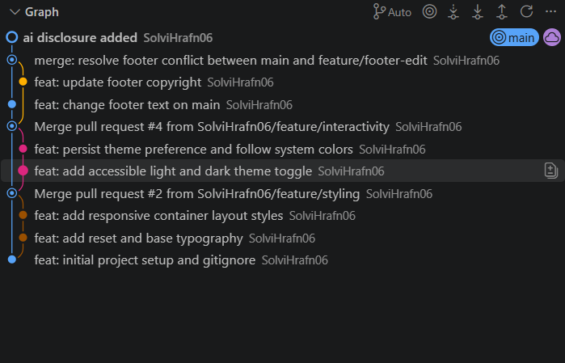

# Kynningarsíðan mín

Persónuleg kynningarsíða fyrir Verkefni 1 í vefþróun. Verkefnið æfir HTML, CSS, JavaScript og GitHub Flow með Issues, afmörkuðum commits og Pull Requests.

## Keyrsla

Opnaðu `index.html` í vafra eða notaðu Live Server í Visual Studio Code. Engin pakkauppsetning er nauðsynleg.

## Myndir

## ai disclosure

Ég notaði gevigreindina ChatGPT til þess að aðstoða við að hanna html og css kóðann hreinlega bara því ég nennti því ekki sjálfur.